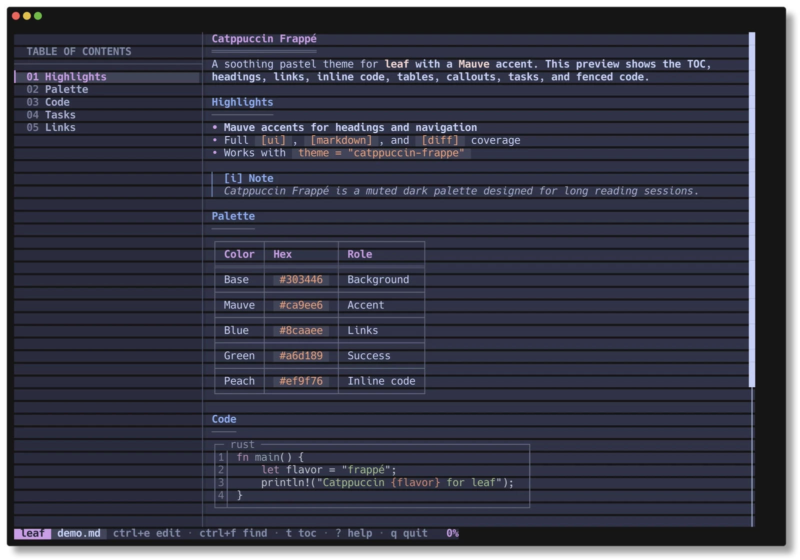

# Catppuccin Frappé for leaf

An unofficial [Catppuccin Frappé](https://catppuccin.com/palette/) theme for [leaf](https://github.com/RivoLink/leaf), the terminal Markdown reader — with a **Mauve** accent.

<p align="center">
  <a href="https://github.com/jehu-fr/leaf-catppuccin/blob/main/LICENSE"></a>
  <a href="https://github.com/RivoLink/leaf"></a>
  <a href="https://catppuccin.com/palette/"></a>
  
  
</p>

<p align="center">
  
</p>

## Features

- **Complete coverage** — styles leaf's UI, Markdown rendering, and diff viewer with all 99 color keys.
- **Mauve accent** — headings, active TOC entries, brand chip, scrollbar, and status percentage.
- **Catppuccin semantics** — Blue links, Green success, Yellow warnings, Red errors, and Peach inline code.
- **Three ways to load** — config-directory theme name, direct file path, or `LEAF_THEME`.
- **Truecolor** — uses 24-bit hex colors from the Catppuccin Frappé palette.

## Requirements

- **leaf 1.29.1 or newer** for full support. Tested with leaf 1.29.2.
- A **truecolor terminal**. 256-color terminals will approximate the palette.
- Code blocks use `base16-ocean.dark` because leaf only loads syntect's bundled syntax themes. The rest of the interface is full Frappé.

## Installation

### Linux / macOS

```bash
mkdir -p ~/.config/leaf/themes
curl -fsSL https://raw.githubusercontent.com/jehu-fr/leaf-catppuccin/main/themes/catppuccin-frappe.toml \
  -o ~/.config/leaf/themes/catppuccin-frappe.toml
```

Set it as your default in `~/.config/leaf/config.toml`:

```toml
theme = "catppuccin-frappe"
```

Or use it for a single file:

```bash
leaf --theme catppuccin-frappe README.md
```

Or for the current shell only:

```bash
export LEAF_THEME=catppuccin-frappe
```

### Windows

In PowerShell:

```powershell
New-Item -ItemType Directory -Force "$env:APPDATA\leaf\themes"
Invoke-WebRequest `
  -Uri "https://raw.githubusercontent.com/jehu-fr/leaf-catppuccin/main/themes/catppuccin-frappe.toml" `
  -OutFile "$env:APPDATA\leaf\themes\catppuccin-frappe.toml"
```

Then set it in `%APPDATA%\leaf\config.toml`:

```toml
theme = "catppuccin-frappe"
```

### From a clone

```bash
git clone https://github.com/jehu-fr/leaf-catppuccin.git
cp leaf-catppuccin/themes/catppuccin-frappe.toml ~/.config/leaf/themes/
```

## Usage

leaf resolves theme names from the `themes` folder next to its config file. The file name becomes the theme name, so `catppuccin-frappe.toml` is selected as `catppuccin-frappe`.

| Method | Example |
| --- | --- |
| Config file | `theme = "catppuccin-frappe"` |
| CLI flag | `leaf --theme catppuccin-frappe file.md` |
| Environment | `LEAF_THEME=catppuccin-frappe leaf file.md` |
| Direct path | `leaf --theme ./themes/catppuccin-frappe.toml file.md` |

Priority is `--theme` > `LEAF_THEME` > `theme` in `config.toml` > `ocean`.

## Palette

<p align="center">
  
</p>

The theme uses Mauve as its primary accent, with the rest of the palette mapped to semantic roles:

| Color | Hex | Used for |
| --- | --- | --- |
| Base | `#303446` | Content background |
| Mantle | `#292c3c` | TOC and status bar |
| Crust | `#232634` | Text on Mauve/Green chips |
| Surface 0 | `#414559` | Active TOC, inline code, chips |
| Surface 1 | `#51576d` | Borders |
| Surface 2 | `#626880` | Frames, rules, separators |
| Overlay 0 | `#737994` | Muted indices and gutters |
| Overlay 1 | `#838ba7` | Secondary UI text |
| Overlay 2 | `#949cbb` | Minor headings and Mermaid arrows |
| Subtext 0 | `#a5adce` | Blockquotes and diff context |
| Subtext 1 | `#b5bfe2` | Diff metadata |
| Text | `#c6d0f5` | Body text |
| Rosewater | `#f2d5cf` | Strong text |
| **Mauve** | **`#ca9ee6`** | **Accent, H1, active TOC, brand** |
| Blue | `#8caaee` | Links, H2, diff filenames |
| Sapphire | `#85c1dc` | Link icons and footnotes |
| Sky | `#99d1db` | Link hover |
| Teal | `#81c8be` | H3 and Mermaid labels |
| Green | `#a6d189` | Success, tasks, additions, H4 |
| Yellow | `#e5c890` | Warnings, search, marks |
| Peach | `#ef9f76` | Inline code, ordered lists, hunk headers |
| Red | `#e78284` | Errors, caution callouts, deletions |

The full 26-color palette is shown in the image above and at [catppuccin.com/palette](https://catppuccin.com/palette/).

## Design notes

Foreground colors are direct Catppuccin Frappé values. A few backgrounds are subtle blends over Base to keep text readable:

| Key | Blend |
| --- | --- |
| `search_highlight_bg` | Yellow 22% over Base |
| `search_match_bg` | Yellow 35% over Base |
| `status_watch_bg`, `status_success_bg`, `diff.add_bg` | Green 18% over Base |
| `status_search_bg` | Yellow 18% over Base |
| `status_error_bg`, `diff.del_bg` | Red 18% over Base |
| `diff.intra_add` | Green 35% over Base |
| `diff.intra_del` | Red 35% over Base |
| `latex_inline_bg` | Mauve 18% over Base |

The `[diff]` section is supported by leaf's diff viewer even though the current theme documentation only lists `[ui]` and `[markdown]`.

`base = "ocean"` provides a fallback for any key that is not overridden, but this theme defines every available key explicitly.

## Customization

Copy the theme file and change any value you like:

```toml
base = "ocean"
syntax = "base16-ocean.dark"

[ui]
scrollbar_hover = "#babbf1"   # Lavender
toc_accent = "#ca9ee6"        # Mauve

[markdown]
heading_1 = "#babbf1"
```

leaf silently ignores unknown keys, so use leaf's [`gruvbox.toml`](https://github.com/RivoLink/leaf/blob/main/gruvbox.toml) as the full key reference. Do not rename existing keys.

## Compatibility

- Full support: **leaf 1.29.1+**.
- The `[diff]` keys require **leaf 1.29.0+**.
- Older versions can use `leaf --theme /path/to/catppuccin-frappe.toml`, but may ignore `[diff]` and cannot select the theme by name from the config directory.
- Tested with **leaf 1.29.2** on Linux.

## Credits

- [leaf](https://github.com/RivoLink/leaf) by RivoLink.
- [Catppuccin](https://catppuccin.com/) palette by the Catppuccin contributors, MIT licensed.
- Packaging conventions inspired by [Rosé Pine for leaf](https://github.com/rose-pine/leaf).
- Theme by [Jehu Frayle](https://github.com/jehu-fr).

This is an unofficial community theme. It is not affiliated with or endorsed by the leaf project or the Catppuccin organization.

## Contributing

Issues and pull requests are welcome. To add another flavor, copy `themes/catppuccin-frappe.toml` to `themes/catppuccin-<flavor>.toml`, replace the palette values, and update this README. Keep the `catppuccin-<flavor>.toml` naming so leaf can select it by name.

## License

[MIT](LICENSE) © 2026 Jehu Frayle. The Catppuccin palette is also MIT licensed.
