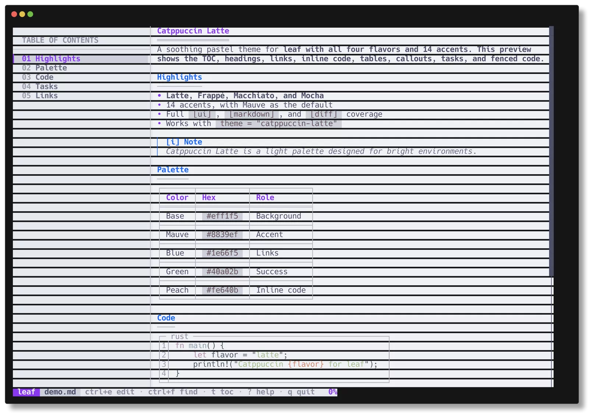
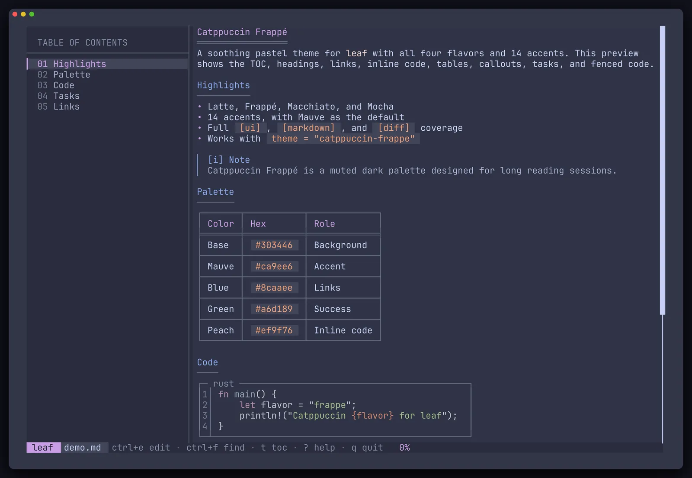
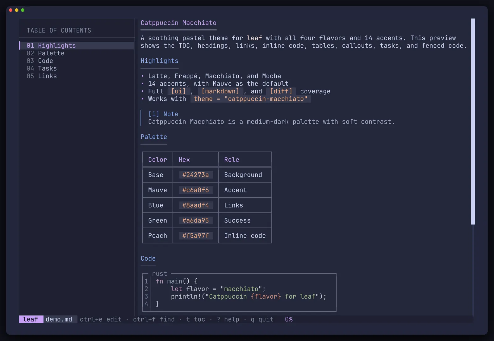
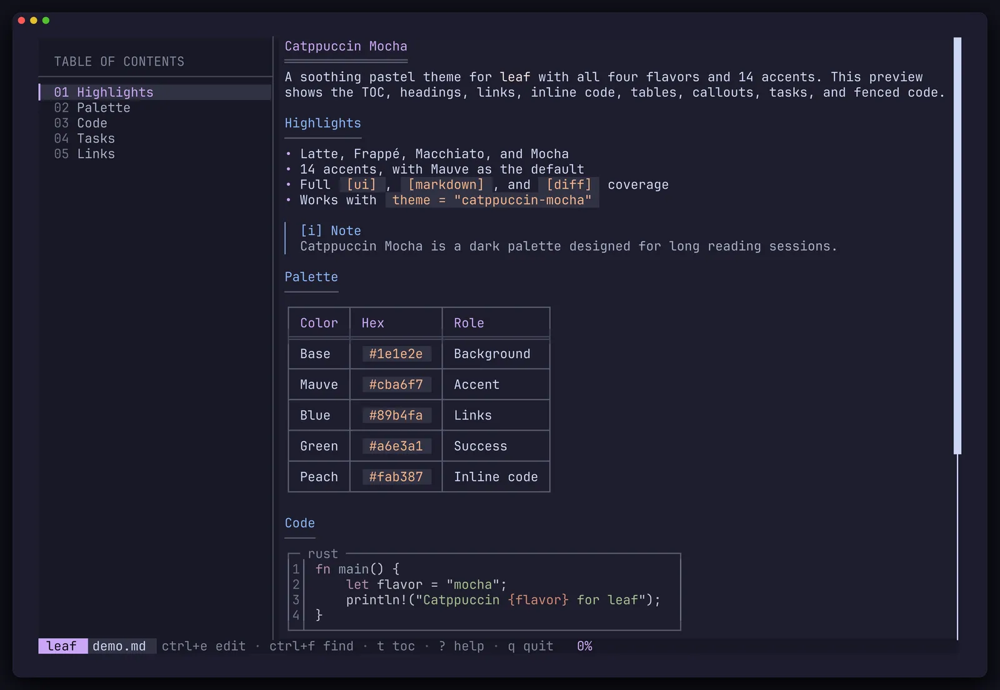
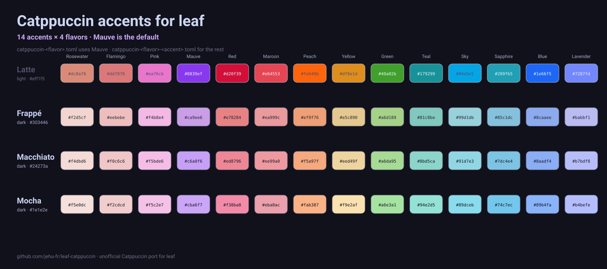
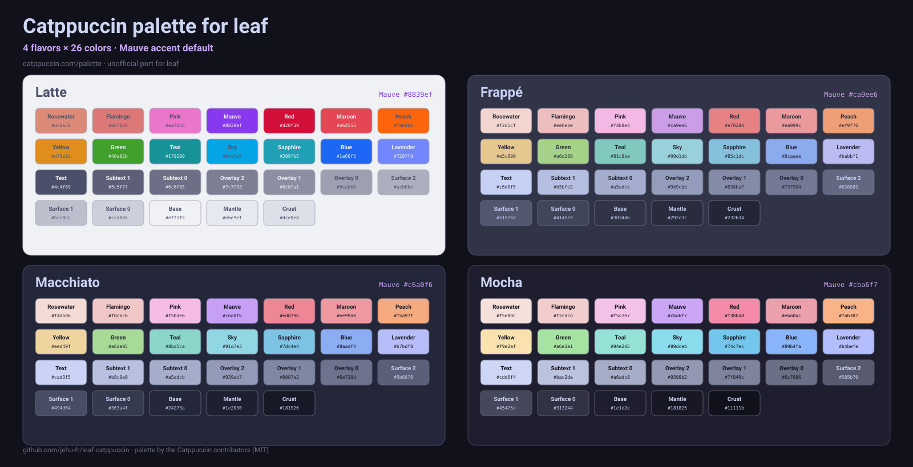

# Catppuccin for leaf

An unofficial [Catppuccin](https://catppuccin.com/palette/) theme for [leaf](https://github.com/RivoLink/leaf), the terminal Markdown reader — **four flavors, fourteen accents, one 99-key theme**.

<p align="center">
  <a href="https://github.com/jehu-fr/leaf-catppuccin/blob/main/LICENSE"></a>
  <a href="https://github.com/RivoLink/leaf"></a>
  <a href="https://catppuccin.com/palette/"></a>
  
  
</p>

<p align="center">
  <a href="assets/preview-latte.webp"></a>
  <a href="assets/preview-frappe.webp"></a>
</p>
<p align="center"><sub><b>Latte</b> · light</sub> &nbsp;&nbsp;&nbsp;&nbsp; <sub><b>Frappé</b> · dark</sub></p>

<p align="center">
  <a href="assets/preview-macchiato.webp"></a>
  <a href="assets/preview-mocha.webp"></a>
</p>
<p align="center"><sub><b>Macchiato</b> · dark</sub> &nbsp;&nbsp;&nbsp;&nbsp; <sub><b>Mocha</b> · dark</sub></p>

## Features

- **Four flavors** — Latte, Frappé, Macchiato, and Mocha.
- **Fourteen accents** — Rosewater, Flamingo, Pink, Mauve, Red, Maroon, Peach, Yellow, Green, Teal, Sky, Sapphire, Blue, and Lavender.
- **56 ready-made themes** — every flavor has a Mauve default plus thirteen accent variants. No Python required to install one.
- **Complete coverage** — styles leaf's UI, Markdown rendering, and diff viewer with all 99 color keys.
- **Catppuccin semantics** — Blue links, Green success, Yellow warnings, Red errors, Peach inline code, and accent-driven headings and navigation.
- **Latte readability fixes** — targeted foreground adjustments where the light palette would otherwise be hard to read, not a wholesale remap.
- **Custom accents** — `scripts/generate.py` can produce a theme for any `#rrggbb` accent.
- **Truecolor** — uses 24-bit hex colors from the Catppuccin palette.

## Requirements

- **leaf 1.29.1 or newer** for full support. Tested with leaf 1.29.2.
- A **truecolor terminal**. 256-color terminals will approximate the palette.
- **Python 3.11+** only if you want to use the generator or validation scripts.
- Code blocks use syntect's bundled syntax themes: `base16-ocean.dark` for the three dark flavors and `base16-ocean.light` for Latte. The rest of the interface is full Catppuccin.

## Quick start

### 1. Pick a flavor

| Flavor | Type | Base | Default accent | Syntax theme | Theme file |
| --- | --- | --- | --- | --- | --- |
| **Latte** | light | `#eff1f5` | Mauve `#8839ef` | `base16-ocean.light` | [`catppuccin-latte.toml`](themes/catppuccin-latte.toml) |
| **Frappé** | dark | `#303446` | Mauve `#ca9ee6` | `base16-ocean.dark` | [`catppuccin-frappe.toml`](themes/catppuccin-frappe.toml) |
| **Macchiato** | dark | `#24273a` | Mauve `#c6a0f6` | `base16-ocean.dark` | [`catppuccin-macchiato.toml`](themes/catppuccin-macchiato.toml) |
| **Mocha** | dark | `#1e1e2e` | Mauve `#cba6f7` | `base16-ocean.dark` | [`catppuccin-mocha.toml`](themes/catppuccin-mocha.toml) |

### 2. Download it

Linux and macOS:

```bash
FLAVOR=mocha
mkdir -p ~/.config/leaf/themes
curl -fsSL "https://raw.githubusercontent.com/jehu-fr/leaf-catppuccin/main/themes/catppuccin-${FLAVOR}.toml" \
  -o ~/.config/leaf/themes/catppuccin-${FLAVOR}.toml
```

Windows PowerShell:

```powershell
$Flavor = "mocha"
New-Item -ItemType Directory -Force "$env:APPDATA\leaf\themes" | Out-Null
Invoke-WebRequest `
  -Uri "https://raw.githubusercontent.com/jehu-fr/leaf-catppuccin/main/themes/catppuccin-$Flavor.toml" `
  -OutFile "$env:APPDATA\leaf\themes\catppuccin-$Flavor.toml"
```

### 3. Select it

Set it as your default in `~/.config/leaf/config.toml`:

```toml
theme = "catppuccin-mocha"
```

Or use it for one file:

```bash
leaf --theme catppuccin-mocha README.md
```

Or for the current shell only:

```bash
export LEAF_THEME=catppuccin-mocha
```

Or point leaf at the file directly:

```bash
leaf --theme ~/.config/leaf/themes/catppuccin-mocha.toml README.md
```

leaf resolves theme names from the `themes` folder next to its config file. The file name becomes the theme name, so `catppuccin-mocha.toml` is selected as `catppuccin-mocha`.

> [!IMPORTANT]
> Custom themes do **not** appear in leaf's `Shift+T` theme picker. That picker only cycles the built-in presets. Select a custom theme with the config file, `--theme`, `LEAF_THEME`, or a direct path.

Priority is `--theme` > `LEAF_THEME` > `theme` in `config.toml` > `ocean`.

### From a clone

```bash
git clone https://github.com/jehu-fr/leaf-catppuccin.git
cp leaf-catppuccin/themes/catppuccin-mocha.toml ~/.config/leaf/themes/
```

## Choosing an accent

<p align="center">
  
</p>

Mauve is the default for every flavor. The four unsuffixed files are the Mauve themes:

```text
themes/catppuccin-latte.toml
themes/catppuccin-frappe.toml
themes/catppuccin-macchiato.toml
themes/catppuccin-mocha.toml
```

Every other accent is a separate file in [`themes/accents/`](themes/accents):

```text
themes/accents/catppuccin-<flavor>-<accent>.toml
```

For example, to install Mocha with a Blue accent:

```bash
mkdir -p ~/.config/leaf/themes
curl -fsSL https://raw.githubusercontent.com/jehu-fr/leaf-catppuccin/main/themes/accents/catppuccin-mocha-blue.toml \
  -o ~/.config/leaf/themes/catppuccin-mocha-blue.toml
```

```toml
theme = "catppuccin-mocha-blue"
```

> [!NOTE]
> leaf only scans the top level of `~/.config/leaf/themes/`. Copy the accent file directly into that folder — do not copy the `themes/accents/` subdirectory into it.

### Accent matrix

Each cell links to the theme file and shows the raw Catppuccin accent hex. Latte applies a few contrast adjustments to foreground roles; open the file to see the exact values.

| Accent | Latte | Frappé | Macchiato | Mocha |
| --- | --- | --- | --- | --- |
| Rosewater | [`#dc8a78`](themes/accents/catppuccin-latte-rosewater.toml) | [`#f2d5cf`](themes/accents/catppuccin-frappe-rosewater.toml) | [`#f4dbd6`](themes/accents/catppuccin-macchiato-rosewater.toml) | [`#f5e0dc`](themes/accents/catppuccin-mocha-rosewater.toml) |
| Flamingo | [`#dd7878`](themes/accents/catppuccin-latte-flamingo.toml) | [`#eebebe`](themes/accents/catppuccin-frappe-flamingo.toml) | [`#f0c6c6`](themes/accents/catppuccin-macchiato-flamingo.toml) | [`#f2cdcd`](themes/accents/catppuccin-mocha-flamingo.toml) |
| Pink | [`#ea76cb`](themes/accents/catppuccin-latte-pink.toml) | [`#f4b8e4`](themes/accents/catppuccin-frappe-pink.toml) | [`#f5bde6`](themes/accents/catppuccin-macchiato-pink.toml) | [`#f5c2e7`](themes/accents/catppuccin-mocha-pink.toml) |
| Mauve | [`#8839ef`](themes/catppuccin-latte.toml) | [`#ca9ee6`](themes/catppuccin-frappe.toml) | [`#c6a0f6`](themes/catppuccin-macchiato.toml) | [`#cba6f7`](themes/catppuccin-mocha.toml) |
| Red | [`#d20f39`](themes/accents/catppuccin-latte-red.toml) | [`#e78284`](themes/accents/catppuccin-frappe-red.toml) | [`#ed8796`](themes/accents/catppuccin-macchiato-red.toml) | [`#f38ba8`](themes/accents/catppuccin-mocha-red.toml) |
| Maroon | [`#e64553`](themes/accents/catppuccin-latte-maroon.toml) | [`#ea999c`](themes/accents/catppuccin-frappe-maroon.toml) | [`#ee99a0`](themes/accents/catppuccin-macchiato-maroon.toml) | [`#eba0ac`](themes/accents/catppuccin-mocha-maroon.toml) |
| Peach | [`#fe640b`](themes/accents/catppuccin-latte-peach.toml) | [`#ef9f76`](themes/accents/catppuccin-frappe-peach.toml) | [`#f5a97f`](themes/accents/catppuccin-macchiato-peach.toml) | [`#fab387`](themes/accents/catppuccin-mocha-peach.toml) |
| Yellow | [`#df8e1d`](themes/accents/catppuccin-latte-yellow.toml) | [`#e5c890`](themes/accents/catppuccin-frappe-yellow.toml) | [`#eed49f`](themes/accents/catppuccin-macchiato-yellow.toml) | [`#f9e2af`](themes/accents/catppuccin-mocha-yellow.toml) |
| Green | [`#40a02b`](themes/accents/catppuccin-latte-green.toml) | [`#a6d189`](themes/accents/catppuccin-frappe-green.toml) | [`#a6da95`](themes/accents/catppuccin-macchiato-green.toml) | [`#a6e3a1`](themes/accents/catppuccin-mocha-green.toml) |
| Teal | [`#179299`](themes/accents/catppuccin-latte-teal.toml) | [`#81c8be`](themes/accents/catppuccin-frappe-teal.toml) | [`#8bd5ca`](themes/accents/catppuccin-macchiato-teal.toml) | [`#94e2d5`](themes/accents/catppuccin-mocha-teal.toml) |
| Sky | [`#04a5e5`](themes/accents/catppuccin-latte-sky.toml) | [`#99d1db`](themes/accents/catppuccin-frappe-sky.toml) | [`#91d7e3`](themes/accents/catppuccin-macchiato-sky.toml) | [`#89dceb`](themes/accents/catppuccin-mocha-sky.toml) |
| Sapphire | [`#209fb5`](themes/accents/catppuccin-latte-sapphire.toml) | [`#85c1dc`](themes/accents/catppuccin-frappe-sapphire.toml) | [`#7dc4e4`](themes/accents/catppuccin-macchiato-sapphire.toml) | [`#74c7ec`](themes/accents/catppuccin-mocha-sapphire.toml) |
| Blue | [`#1e66f5`](themes/accents/catppuccin-latte-blue.toml) | [`#8caaee`](themes/accents/catppuccin-frappe-blue.toml) | [`#8aadf4`](themes/accents/catppuccin-macchiato-blue.toml) | [`#89b4fa`](themes/accents/catppuccin-mocha-blue.toml) |
| Lavender | [`#7287fd`](themes/accents/catppuccin-latte-lavender.toml) | [`#babbf1`](themes/accents/catppuccin-frappe-lavender.toml) | [`#b7bdf8`](themes/accents/catppuccin-macchiato-lavender.toml) | [`#b4befe`](themes/accents/catppuccin-mocha-lavender.toml) |

See [`docs/ACCENTS.md`](docs/ACCENTS.md) for the full accent reference, the accent-driven key list, and custom-accent recipes.

## Palette

<p align="center">
  
</p>

The theme uses the 26 official Catppuccin colors per flavor. Accent colors drive headings, active TOC entries, the brand chip, the scrollbar, inline LaTeX, Mermaid keywords, and other highlights; the remaining colors keep their semantic roles:

| Role | Color |
| --- | --- |
| Background | Base |
| Secondary panes | Mantle |
| Borders and frames | Surface 1 / Surface 2 |
| Muted UI text | Overlay 0 / Overlay 1 / Overlay 2 |
| Secondary text | Subtext 0 / Subtext 1 |
| Body text | Text |
| Links | Blue |
| Success, tasks, additions | Green |
| Warnings, search, marks | Yellow |
| Inline code, ordered lists | Peach |
| Errors, caution callouts, deletions | Red |
| Accent | Mauve by default; any of the 14 accents |

The full palette is shown above and at [catppuccin.com/palette](https://catppuccin.com/palette/).

## Custom accents

The generator uses only the Python standard library and reads the official palette from [`src/palette.json`](src/palette.json) plus the 99-key template from [`src/template.toml`](src/template.toml).

```bash
# List flavors and accents
python3 scripts/generate.py --list

# Print a theme to stdout
python3 scripts/generate.py --flavor mocha --accent blue

# Write it anywhere
python3 scripts/generate.py --flavor mocha --accent blue \
  --output ~/.config/leaf/themes/catppuccin-mocha-blue.toml

# Install into $XDG_CONFIG_HOME/leaf/themes (or ~/.config/leaf/themes)
python3 scripts/generate.py --flavor mocha --accent blue --install

# Any #rrggbb accent, written as catppuccin-mocha-custom.toml
python3 scripts/generate.py --flavor mocha --accent-hex "#ff79c6" --install

# Regenerate all 56 committed themes
python3 scripts/generate.py --all

# Fail if committed themes drift from the generator
python3 scripts/generate.py --check
```

`--install` respects `XDG_CONFIG_HOME`, so you can test safely without touching your live leaf configuration:

```bash
XDG_CONFIG_HOME=/tmp/leaf-test \
  python3 scripts/generate.py --flavor latte --accent teal --install
```

You can also edit any generated TOML by hand. Keep the key names unchanged; leaf silently ignores unknown keys, so use leaf's [`gruvbox.toml`](https://github.com/RivoLink/leaf/blob/main/gruvbox.toml) as the full key reference.

## Design notes

### Schema

Each theme defines the complete leaf schema: **35 `[ui]` keys, 47 `[markdown]` keys, and 17 `[diff]` keys**, plus `base` and `syntax`.

`base` only accepts leaf's built-in presets. Custom themes cannot inherit from other custom themes, so every flavor uses a built-in preset for any key it does not override:

| Flavor | `base` | `syntax` |
| --- | --- | --- |
| Latte | `arctic` | `base16-ocean.light` |
| Frappé | `ocean` | `base16-ocean.dark` |
| Macchiato | `ocean` | `base16-ocean.dark` |
| Mocha | `ocean` | `base16-ocean.dark` |

### Blend formulas

Foreground colors are direct Catppuccin values. A few backgrounds are subtle blends over each flavor's Base:

| Key | Blend |
| --- | --- |
| `search_highlight_bg` | Yellow 22% over Base |
| `search_match_bg` | Yellow 35% over Base |
| `status_watch_bg`, `status_success_bg`, `diff.add_bg` | Green 18% over Base |
| `status_search_bg` | Yellow 18% over Base |
| `status_error_bg`, `diff.del_bg` | Red 18% over Base |
| `diff.intra_add` | Green 35% over Base |
| `diff.intra_del` | Red 35% over Base |
| `latex_inline_bg` | Accent 18% over Base |

`status_brand_fg` and `status_reloaded_fg` are chosen by highest contrast among Crust, Base, and Text.

### Latte readability fixes

Latte is a light palette, so a few raw color pairs are below comfortable contrast. The Latte themes keep the palette but adjust only the affected roles:

- `strong_text` uses Text instead of Rosewater.
- `inline_code_fg` uses a darker Peach blend on Surface 0.
- `link_hover` uses Blue instead of Sky.
- Status success/watch/search/warning foregrounds use darker Green/Yellow blends where needed.
- `mark_fg` uses Text and `mark_bg` uses Yellow 35% over Base.
- Diff add/delete foregrounds use darker Green/Red blends on their tinted backgrounds.
- Accent foreground roles are darkened only enough to reach about 3:1 on their background; decorative accent backgrounds keep the raw accent.

The dark flavors use the raw Catppuccin foreground colors. The existing Frappé Mauve theme is color-identical to the 1.0.0 release.

## Validation

```bash
python3 scripts/generate.py --check   # committed files match the generator
python3 scripts/check.py              # schema, hex, accent isolation, contrast
python3 scripts/assets.py             # regenerate assets/accents.svg and assets/palette.svg
```

`scripts/check.py` verifies all 56 files, the 35/47/17 key counts, `#rrggbb` values, flavor presets, accent isolation, and a set of foreground/background contrast pairs. All 56 themes were also loaded through leaf 1.29.2 with a temporary `XDG_CONFIG_HOME`.

## Compatibility

- Full support: **leaf 1.29.1+**.
- The `[diff]` keys require **leaf 1.29.0+**.
- Older versions can use `leaf --theme /path/to/catppuccin-<flavor>.toml`, but may ignore `[diff]` and cannot select the theme by name from the config directory.
- Custom themes do not appear in `Shift+T`; use the config file, `--theme`, `LEAF_THEME`, or a direct path.
- Tested with **leaf 1.29.2** on Linux.

## Repository layout

```text
themes/                    4 Mauve defaults
themes/accents/            52 non-Mauve variants
src/palette.json           vendored official Catppuccin palette (v1.8.0)
src/template.toml          99-key leaf theme template
scripts/generate.py        generator CLI
scripts/check.py           schema and contrast validation
scripts/assets.py          SVG asset generator
docs/ACCENTS.md            accent reference and recipes
assets/                    previews, accent grid, palette card
demo/demo.md               showcase document used for previews
```

## Credits

- [leaf](https://github.com/RivoLink/leaf) by RivoLink.
- [Catppuccin](https://catppuccin.com/) palette by the Catppuccin contributors, MIT licensed.
- Packaging conventions inspired by [Rosé Pine for leaf](https://github.com/rose-pine/leaf).
- Theme by [Jehu Frayle](https://github.com/jehu-fr).

This is an unofficial community theme. It is not affiliated with or endorsed by the leaf project or the Catppuccin organization.

## Contributing

Issues and pull requests are welcome. To change a color, edit [`src/template.toml`](src/template.toml) or [`src/palette.json`](src/palette.json), then run:

```bash
python3 scripts/generate.py --all
python3 scripts/check.py
python3 scripts/assets.py
```

Commit the regenerated themes and assets with the source change. Add a changelog entry for user-visible changes.

## License

[MIT](LICENSE) © 2026 Jehu Frayle. The Catppuccin palette is also MIT licensed.
